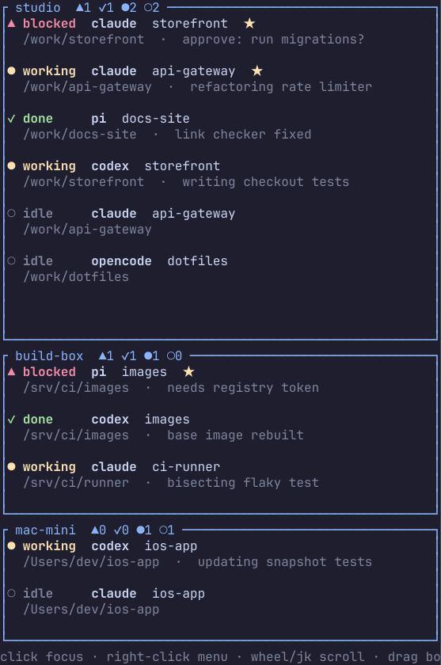

# Bistro

This is Bistro.

Bistro shows your [Herdr](https://herdr.dev) and Orca agents in one tall list. It is made for vertical monitors. It looks like the menu board outside a bistro.



## Install

```sh
curl -fsSL https://raw.githubusercontent.com/evanbrobertson/bistro/main/install.sh | sh
```

This installs `bistro` to `~/.local/bin`. Make sure that folder is in your `PATH`.

To get the beta version:

```sh
curl -fsSL https://raw.githubusercontent.com/evanbrobertson/bistro/main/install.sh | BISTRO_CHANNEL=beta sh
```

To install to a different folder, set `BISTRO_INSTALL_DIR`.

## Use

Install Herdr, Orca, or both, and put their CLIs in your `PATH`. Run:

```sh
bistro
```

- Click an agent to jump to it in Herdr or Orca.
- Right-click an agent for a menu. Choose **Pin** to keep it at the top.
- Bistro updates when local Herdr says something changed. Remote Herdr machines and Orca refresh every two seconds.
- Orca appears in its own `orca:local` panel when its CLI is installed. Orca agents without a status report appear as idle; waiting agents appear as blocked.
- Each saved Orca environment appears in an `orca:<name>` panel. Bistro discovers new environments every 30 seconds and refreshes each panel every two seconds. Clicks focus terminals through that environment. Pins stay with the environment ID even if its name changes.

To include a remote Orca server, save it on the machine running Bistro using Orca's **Settings > Managed servers** or its CLI:

```sh
orca environment add --name my-server --pairing-code '<pairing code from the server>'
orca environment list --json
```

Bistro queries the local runtime and each saved environment explicitly, independently of `ORCA_ENVIRONMENT` or pairing-code environment variables. SSH-managed terminals already reported by a runtime are included in that runtime's panel. If Orca reports hosts it did not cover, Bistro shows a coverage message. An offline server shows its own error while other panels continue updating.

The Orca app launcher may be named `stably-orca` on Linux. Its CLI is normally `orca-ide` on Linux and `orca` on macOS. Bistro prefers `orca-ide` when available because Linux's GNOME screen reader is also named `orca`. Both executables are searched in `PATH`.

To select the CLI explicitly (also useful for an AppImage or custom install):

```sh
BISTRO_ORCA_CLI=/path/to/orca-ide bistro
```

Use the IDE's CLI executable rather than its GUI launcher. `bistro --list` includes the selected CLI path in each Orca result.

To diagnose discovery without starting the terminal UI:

```sh
bistro --list
```

This prints each source's agents, remote environment ID, errors, and coverage warnings as JSON.
- Bistro remembers your pins and panel sizes in `~/.config/bistro/state.json`.

## Develop

You need [Rust](https://rustup.rs).

```sh
cargo run              # run Bistro
cargo fmt --all        # format
cargo clippy --all-targets -- -D warnings
cargo test
```

The screenshots in `docs/screenshots` use made-up data. To make them again:

```sh
cargo test screenshots -- --ignored
for n in 1 2 3; do rsvg-convert -z 1 docs/screenshots/bistro-$n-hosts.svg -o docs/screenshots/bistro-$n-hosts.png; done
```

Rules for changes:

- Open a pull request. Do not push to `main`.
- Write the pull request title as a [Conventional Commit](https://www.conventionalcommits.org), for example `feat: add a filter`. The title sets the next version.
- `feat` makes a minor version. `fix` and `perf` make a patch version. `!` (for example `feat!:`) makes a breaking change.

## Releases

Every merge to `main` that has a `feat`, `fix`, `perf`, or breaking change makes a new release. Nothing is released for `docs`, `chore`, `ci`, `test`, `style`, or `refactor`.

| Branch            | What it holds                                |
| ----------------- | -------------------------------------------- |
| `main`            | Trunk. All work lands here.                  |
| `release/develop` | Always the same as `main`.                   |
| `release/beta`    | The newest release.                          |
| `release/stable`  | The newest release you promoted by hand.     |

To move a release to stable, go to **Actions**, pick **Promote**, and enter the tag (for example `v0.2.0`). Nothing is rebuilt. The same files that were in beta become stable.

## License

MIT
